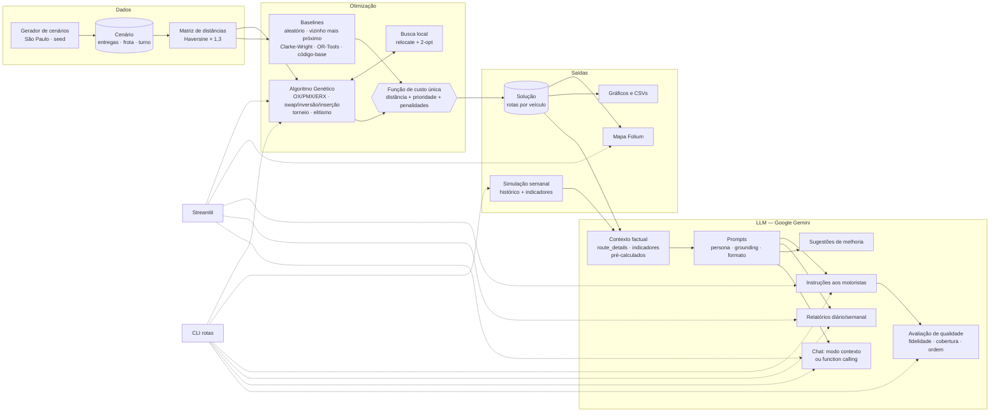
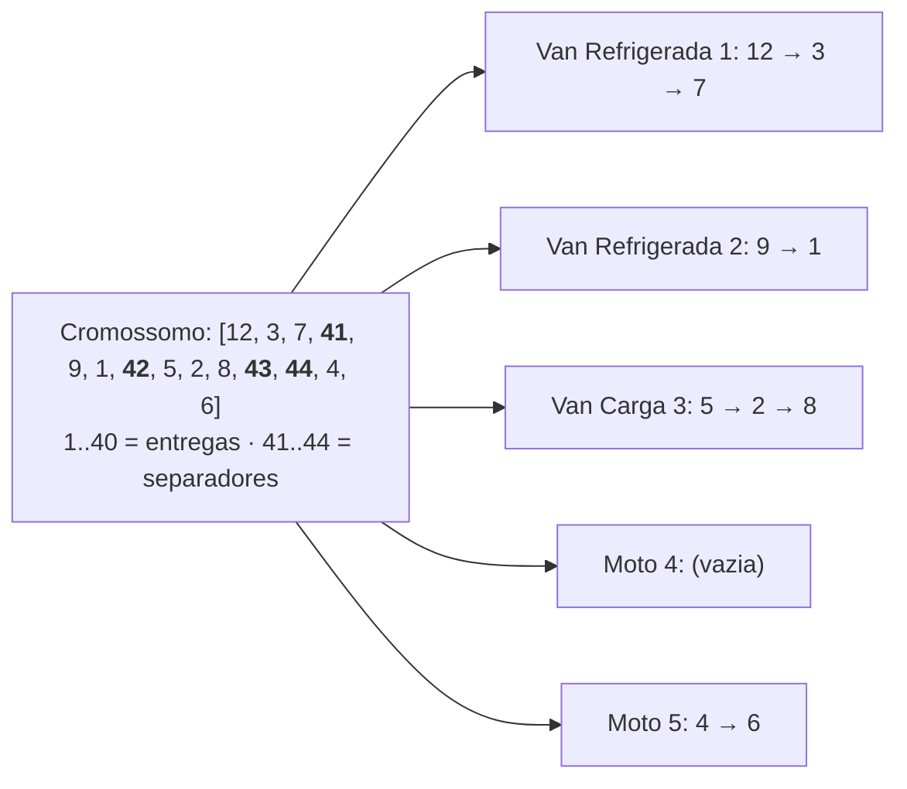
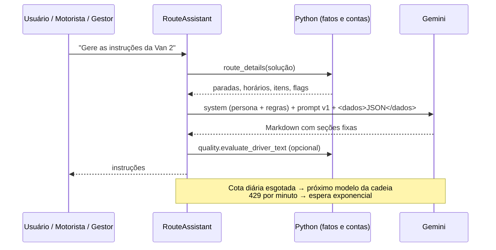

# Arquitetura

## Visão geral



## Representação genética



Cada rota é simulada no tempo, do depósito às 08:00 até o retorno. São acumulados distância,
carga, horário de chegada (com espera, se o veículo chegar antes da janela abrir) e atrasos.

## Laço evolutivo

```mermaid
flowchart TD
    A[População inicial aleatória] --> B[Avaliar custo<br/>cache por cromossomo]
    B --> C{AG memético e<br/>geração múltipla de 10?}
    C -- sim --> D[relocate + 2-opt<br/>nos 2 melhores]
    C -- não --> E
    D --> E[Elitismo: copia os 2 melhores]
    E --> F[Seleção por torneio k=3]
    F --> G[Cruzamento OX p=0,9]
    G --> H[Mutação p=0,6<br/>swap | inversão | inserção]
    H --> I{Gerações<br/>esgotadas?}
    I -- não --> B
    I -- sim --> J[Melhor solução]
```

## Fluxo da LLM



## Componentes e responsabilidades

| Módulo | Responsabilidade |
|---|---|
| `domain.py`, `geo.py`, `scenario.py` | Modelo do problema e geração de instâncias reprodutíveis |
| `evaluation.py` | Decodificação, simulação no tempo, custo e restrições. É a **fonte única de verdade** |
| `ga/` | Operadores, laço evolutivo, busca local |
| `baselines/` | Métodos de comparação, todos reavaliados pela mesma função de custo |
| `solution.py` | Persistência e descrição detalhada das rotas, que é o contexto factual da LLM |
| `simulation.py` | Semana simulada e indicadores agregados |
| `llm/` | Provedores, prompts, assistente e avaliação de qualidade |
| `viz/` | Mapa interativo e gráficos |
| `cli.py`, `app/` | Interfaces |

## Observabilidade

- Logs com `logging`: o AG registra o progresso a cada 25 gerações, e o provedor de LLM
  registra novas tentativas, troca de modelo e erros de cota.
- `results/run_info.json` guarda os parâmetros de cada rodada de experimentos.
- A avaliação de LLM registra qual modelo gerou cada texto (coluna `modelo`).
