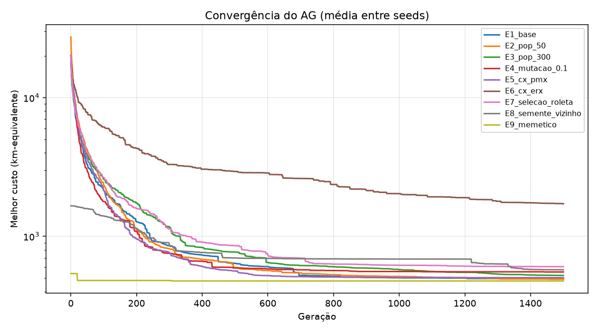
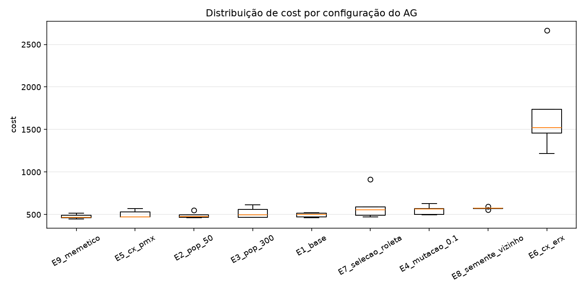
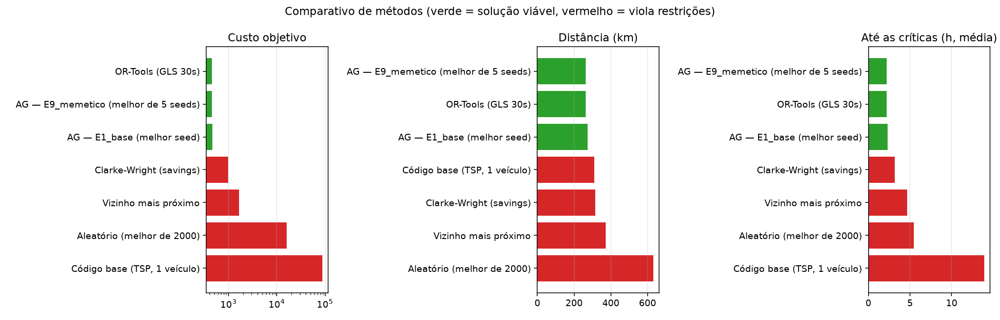

# Relatório Técnico: Otimização de Rotas para Distribuição de Medicamentos e Insumos

**Tech Challenge, Fase 2, Projeto 2 · FIAP Pós Tech IA para Devs (IADT)**

---

## 1. Contexto e escopo

A Central de Distribuição Farmacêutica de um hospital universitário em São Paulo abastece,
todos os dias, UBSs, clínicas de especialidades, hospitais-dia e pacientes em atendimento
domiciliar. O problema tem quatro características que o tornam mais difícil que o "caixeiro
viajante" clássico:

- **vários veículos** diferentes entre si: vans refrigeradas, van de carga e motos;
- **restrições operacionais**: capacidade, autonomia, cadeia fria, janelas de horário dos
  pacientes e fim do turno;
- **prioridade clínica**: quimioterápicos e drogas de UTI precisam chegar antes;
- **comunicação**: motoristas e gestores precisam de instruções e relatórios claros.

Trata-se, portanto, de um **VRP heterogêneo com janelas de tempo e prioridades**. A solução
combina um **Algoritmo Genético** (otimização) com uma **LLM** (Google Gemini) para comunicação.

### Cenário de avaliação

As instâncias são geradas de forma reprodutível (`rotas/scenario.py`) a partir de coordenadas
reais de 27 distritos de São Paulo, com deslocamento aleatório de cerca de 1 km. Os nomes das
unidades são fictícios. A distância é calculada pela fórmula de Haversine multiplicada por um
**fator de circuidade de 1,3**, que aproxima o percurso pelas ruas.

| Cenário padrão (seed 42) | Valor |
|---|---|
| Entregas | 40 (17 domiciliares, 13 UBS, 6 clínicas, 4 hospitais-dia) |
| Demanda total | 849,9 kg |
| Prioridades | 9 críticas · 11 urgentes · 20 regulares |
| Cadeia fria | 13 entregas refrigeradas |
| Janelas de horário | 17 (pacientes domiciliares, 2 a 3 h cada) |
| Turno | 08:00–17:00 |

| Frota | Capacidade | Autonomia | Velocidade média | Refrigerado | R$/km |
|---|---:|---:|---:|:---:|---:|
| Van Refrigerada 1 e 2 | 400 kg | 180 km | 22 km/h | ✅ | 1,80 |
| Van Carga 3 | 600 kg | 200 km | 22 km/h | ❌ | 1,50 |
| Moto 4 e 5 | 25 kg | 120 km | 32 km/h | ❌ | 0,50 |

---

## 2. Do código-base ao AG para VRP

### 2.1 O que o código-base oferecia

O repositório fornecido (`legacy/`) resolve um **TSP puro**: um caixeiro, sem depósito, com
distância euclidiana em pixels e visualização em Pygame. Os indivíduos são listas de tuplas de
coordenadas. Ele traz o cruzamento OX, uma mutação que troca duas cidades vizinhas, seleção
proporcional a 1/distância e elitismo de 1 indivíduo.

### 2.2 Bugs encontrados e corrigidos (anotados com `CORREÇÃO (Fase 2)`)

| Arquivo | Problema | Efeito |
|---|---|---|
| `tsp.py` | `order_crossover(parent1, parent1)` | O filho era sempre cópia do pai, então **não havia cruzamento**; a evolução dependia só da mutação. |
| `draw_functions.py` | `renderer.tostring_rgb()` | Função removida no matplotlib 3.10+, o que quebrava a visualização. |
| `draw_functions.py` | `draw_text` usava `np` e `HEIGHT` sem defini-los | `NameError` ao chamar a função. |
| `genetic_algorithm.py` | OX baseado em `gene not in child` sobre tuplas | Custo O(n²) e erro com dois pontos de mesma coordenada. Corrigido na nova implementação, que usa índices inteiros e conjunto. |

### 2.3 Representação genética

O cromossomo é uma **permutação de `n + K − 1` inteiros distintos**: os valores `1..n` são as
entregas e os valores `n+1..n+K−1` são **separadores** de rota. Os separadores cortam a
permutação em K segmentos, e o segmento *j* é a rota do veículo *j*:

```
[12, 3, 7, 41, 9, 1, 42, 5, 2, 8, 43, 44, 4, 6]
 └ Van 1 ┘    └Van 2┘    └ Van 3 ┘   Moto 4 vazia   └Moto 5┘
```

Por que essa representação:
- continua sendo uma permutação, então **todos os operadores de TSP** (inclusive o OX do
  código-base) funcionam sem adaptação e nunca geram indivíduos inválidos;
- a **atribuição entrega → veículo** é aprendida pelo próprio AG, porque mover um separador
  realoca entregas entre veículos;
- com frota mista, cada posição de segmento corresponde a um veículo específico, de modo que o
  AG também aprende **qual tipo de veículo** é melhor para cada grupo de entregas.

### 2.4 Função de custo (fitness)

Cada rota é **simulada no tempo**: o veículo sai do depósito às 08:00, se desloca à velocidade
média do tipo de veículo, espera se chegar antes da janela abrir, gasta o tempo de serviço em
cada parada e volta ao depósito. O custo, a ser **minimizado**, é:

```
custo = distância_total_km
      + Σ peso_prioridade × horas_até_atendimento     (crítica 6, urgente 2, regular 0 km/h)
      + 5 km × veículos acionados
      + penalidades proporcionais às violações
```

Todas as parcelas estão em "km-equivalentes". Os pesos significam que **uma hora a mais de
espera de uma entrega crítica equivale a 6 km rodados**.

O custo é **separável por rota**: o total é a soma dos custos de cada rota. Isso permite que a
busca local reavalie só as rotas alteradas.

### 2.5 Operadores genéticos

| Operador | Implementações | Observação |
|---|---|---|
| Seleção | **Torneio (k=3)**, roleta 1/custo (a do código-base) | Elitismo de 2 indivíduos |
| Cruzamento | **OX** (reescrito), **PMX**, **ERX** (Edge Recombination) | Todos preservam a permutação; há testes de propriedade em `tests/test_operators.py` |
| Mutação | **troca** de 2 genes, **inversão** de segmento (equivale ao 2-opt, que era `TODO` na base), **inserção** (realoca entrega ou separador) | Um operador sorteado por mutação |
| Busca local (memético) | **relocate** inter-rotas + **2-opt** intra-rota nos 2 melhores a cada 10 gerações | Aceita só movimentos que melhoram |
| Inicialização | aleatória; opcionalmente semeada com o vizinho mais próximo (o outro `TODO` da base) | Avaliada no experimento E8 |

Há ainda um **cache de avaliação** por cromossomo, que evita recalcular elites e filhos idênticos.

---

## 3. Estratégias para as restrições

Todas as restrições são **suaves** (penalidade proporcional à violação) em vez de rígidas
(descarte do indivíduo). Com descarte, a maior parte da população aleatória inicial seria
eliminada. Com penalidades graduais, o AG consegue "caminhar" de soluções inviáveis para
viáveis. Os pesos foram calibrados para que **qualquer violação custe mais do que a economia de
distância que ela proporciona**. Por isso as melhores soluções do AG terminam viáveis.

| Restrição | Como é modelada | Penalidade |
|---|---|---|
| **Prioridade** (crítica > urgente > regular) | Custo proporcional à hora de atendimento, ponderado pela prioridade | 6 / 2 / 0 km por hora |
| **Capacidade de carga** | Soma das demandas da rota comparada à capacidade do veículo | 10 por kg excedente |
| **Autonomia** | Distância da rota comparada à autonomia do veículo | 10 por km excedente |
| **Múltiplos veículos (VRP)** | Separadores na permutação; custo fixo por veículo acionado | 5 por veículo |
| **Frota mista** | Cada segmento usa a capacidade, autonomia e velocidade do seu veículo | — |
| **Cadeia fria** *(restrição extra)* | Entrega refrigerada em veículo sem refrigeração | 300 por entrega |
| **Janelas de horário** *(restrição extra)* | Espera se chegar cedo; atraso se chegar depois do fim da janela | 10 por minuto de atraso |
| **Fim de turno** *(restrição extra)* | Retorno ao depósito depois das 17:00 | 10 por minuto |

---

## 4. Experimentos com o AG

**Protocolo:** cenário padrão; **9 configurações × 5 seeds × 1.500 gerações**. Cada
configuração altera **um único fator** em relação à base (população 150, OX, mutação 0,6,
torneio k=3, elitismo 2, sem semente, sem busca local). As execuções rodam em paralelo
(`ProcessPoolExecutor`).

| Experimento | Fator alterado | Custo médio ± desvio | Melhor | Viáveis | Até críticas | Tempo médio |
|---|---|---:|---:|---:|---:|---:|
| **E9 memético** | + relocate/2-opt | **477,1 ± 25,6** | **449,6** | 80% | **2,28 h** | 21,8 s |
| E2 população 50 | população 150 → 50 | 490,8 ± 37,2 | 461,3 | 100% | 2,44 h | **4,6 s** |
| E1 base | — | 495,8 ± 26,5 | 463,8 | 100% | 2,44 h | 15,4 s |
| E5 PMX | OX → PMX | 503,3 ± 44,6 | 470,7 | 80% | 2,49 h | 16,6 s |
| E3 população 300 | população 150 → 300 | 522,5 ± 65,2 | 465,2 | 80% | 2,55 h | 36,9 s |
| E4 mutação 0,1 | mutação 0,6 → 0,1 | 553,9 ± 55,6 | 499,0 | 80% | 2,62 h | 7,2 s |
| E8 semente NN | 10% da população inicial vinda do vizinho mais próximo | 573,7 ± 14,0 | 554,6 | 100% | 2,82 h | 16,8 s |
| E7 roleta | torneio → roleta 1/custo | 604,9 ± 180,4 | 471,5 | 80% | 2,47 h | 22,1 s |
| E6 ERX | OX → ERX | 1.719,4 ± 558,2 | 1.220,2 | 0% | 3,08 h | 51,8 s |




### Análise

1. **A busca local é o fator de maior impacto.** O E9 tem a menor média e o melhor resultado
   absoluto, empatando com o OR-Tools. O AG faz a exploração global e a busca local faz o
   refinamento: a combinação clássica de um algoritmo memético. Em 1 das 5 seeds, porém, a
   melhor solução terminou com uma pequena violação. Para produção, recomendamos rodar 3 a
   5 seeds e ficar com a melhor viável.
2. **Mutação alta ajuda.** Na calibração inicial (mutação 0,3, com semente NN), 2 de 3 seeds
   terminaram inviáveis (custo médio 757). Subindo só a mutação para 0,6, as 3 ficaram viáveis
   (média 569). No experimento formal, mutação 0,1 (E4) piora o custo médio em 12% em relação
   à base. Com 45 genes e muitas restrições, manter a diversidade é essencial.
3. **Semear com o vizinho mais próximo atrapalha (E8).** A heurística implementava um `TODO` do
   código-base, mas a população converge para a bacia de atração dela: o desvio-padrão é baixo
   (14), mas a média é ruim (573,7). Por isso ela ficou **desligada** na configuração padrão.
4. **População menor não é necessariamente pior (E2 contra E3).** Com o número de gerações
   fixo, a população de 50 teve qualidade próxima da base em **um terço do tempo**. A de 300
   avaliou 2,3 vezes mais indivíduos e ainda não havia convergido em 1.500 gerações, porque o
   torneio k=3 exerce pressão seletiva menor numa população grande.
5. **A roleta do código-base é instável (E7):** desvio de 180. Como os custos das soluções boas
   são próximos entre si, 1/custo dá probabilidades quase iguais, o que deixa a pressão seletiva
   fraca e errática.
6. **O ERX não combina com separadores (E6).** O ERX preserva *adjacências*, mas ignora a
   *posição* dos genes, e é a posição dos separadores que define qual veículo atende quais
   entregas. O resultado é uma atribuição embaralhada e nenhuma solução viável. É um bom exemplo
   de que o operador precisa ser adequado à representação escolhida.

---

## 5. Comparativo com outras abordagens de roteamento

Todos os métodos resolvem o **mesmo cenário** e são **reavaliados pela mesma função de custo**.

| Método | Custo | Distância | R$ operação | Viável | Até críticas | Veículos | Tempo |
|---|---:|---:|---:|:---:|---:|---:|---:|
| **AG memético** (melhor de 5 seeds) | **449,6** | **264,1 km** | 424,39 | ✅ | **2,17 h** | 4 | 21,8 s* |
| OR-Tools (busca local guiada, 30 s) | 449,1 | 264,6 km | 424,22 | ✅ | 2,20 h | 4 | 30,0 s |
| AG padrão (melhor seed) | 463,8 | 273,7 km | 470,02 | ✅ | 2,31 h | 3 | 15,4 s* |
| Clarke-Wright (savings) | 979,1 | 314,1 km | 490,75 | ❌ | 3,14 h | 4 | 0,01 s |
| Vizinho mais próximo | 1.659,7 | 371,6 km | 637,14 | ❌ | 4,67 h | 3 | <0,01 s |
| Aleatório (melhor de 2.000) | 15.994,7 | 630,6 km | 803,69 | ❌ | 5,43 h | 5 | 0,07 s |
| Código-base (TSP, 1 veículo) | 87.668,8 | 311,1 km | 466,70 | ❌ | 13,91 h | 1 | 6,6 s |

\* tempo médio de uma execução (seed).



- **AG contra heurísticas clássicas:** em relação ao vizinho mais próximo, o AG percorre
  **29% menos distância**, entrega as críticas **2,1 vezes mais rápido** e respeita todas as
  restrições. O vizinho mais próximo deixa 3 refrigerados em veículo comum e excede 1,2 kg de
  carga; o Clarke-Wright deixa 1 refrigerado sem refrigeração e 12 min de atraso.
- **AG contra OR-Tools**, a referência industrial de VRP: diferença de **0,1% no custo**, com o
  AG percorrendo 0,5 km a menos e entregando as críticas um pouco antes.
- **Código-base:** a volta única tem distância razoável (311 km), mas é inviável: excede
  250 kg de carga e 111 km de autonomia, leva 13 refrigerados em veículo comum e soma quase
  13 h de turno extra. É isso que motiva todas as extensões.

### 5.1 Escalabilidade (`scripts/scalability.py`)

Cenários com seed 7; frota de 5 veículos até 40 entregas e de 8 veículos com 80.

| Entregas | AG memético | OR-Tools (30 s) | Clarke-Wright | Vizinho mais próximo |
|---:|---:|---:|---:|---:|
| 20 | **296,5** ✅ (6,6 s) | **296,5** ✅ (30 s) | 402,2 ✅ | 670,9 ❌ |
| 40 | **826,3** ❌ (14,6 s) | 3.919,3 ❌ | 1.354,8 ❌ | 2.081,3 ❌ |
| 80 | **915,0** ✅ (46 s) | 1.560,0 ❌ | 3.364,7 ❌ | 3.267,0 ❌ |

- Com 20 entregas, AG e OR-Tools chegam **à mesma solução**, o que indica um ótimo provável, e
  o AG é 4,5 vezes mais rápido.
- Com 80 entregas, **apenas o AG encontrou solução viável**.
- A instância de 40 entregas com seed 7 parece **inviável** com essa frota, já que nenhum
  método a resolveu. Nela, o AG minimiza o tamanho das violações.
- **Ressalva:** o OR-Tools otimiza o próprio modelo de restrições suaves, com pesos e
  granularidade diferentes, e não a nossa função de custo. Em instâncias apertadas, isso o
  desfavorece na comparação. A conclusão justa é que **o AG é competitivo com o OR-Tools em
  qualidade e mais flexível**: qualquer regra de negócio entra direto na função de custo, sem
  precisar ser reformulada como dimensão do solver.

---

## 6. Visualizações

- **Mapas interativos** (Folium/OpenStreetMap): `results/mapa_ag.html`,
  `results/mapa_vizinho_mais_proximo.html` e `results/mapa_codigo_base.html`. Cada veículo tem
  uma cor, há uma camada por veículo, marcadores por prioridade e popups com itens, carga,
  horário previsto e janela.
- **Gráficos**: convergência, boxplot por configuração e comparativo de métodos (`results/*.png`).
- **App Streamlit** (`app/streamlit_app.py`): otimização com convergência ao vivo, mapa, tabela
  da frota, comparativo, instruções, relatórios e chat.
- **Notebook** (`notebooks/demo.ipynb`): demonstração executada de ponta a ponta.

---

## 7. Integração com LLM

### 7.1 Arquitetura

- **Provedor:** Google Gemini, plano gratuito, pelo SDK oficial `google-genai`. Há também um
  provedor **mock** offline e determinístico, usado nos testes e quando não há chave.
- **Cadeia de modelos de reserva:** o plano gratuito do `gemini-3.5-flash` permitiu apenas
  **20 requisições por dia**, e esgotamos essa cota durante o desenvolvimento. Ao detectar o
  erro de cota *diária*, o provedor passa para o próximo modelo da lista
  (`gemini-3.5-flash-lite`, depois `gemini-3.1-flash-lite`). Erros por minuto (429), erros
  5xx e quedas de conexão são tratados com espera exponencial. O modelo que gerou cada texto
  fica registrado.
- **Fonte única de fatos:** `solution.route_details()` produz o contexto factual (paradas,
  horários, itens, ocupação). **Todas as contas** (economias, percentuais, totais semanais) são
  feitas em Python (`simulation.py` e `assistant.comparison_indicators`) e entregues prontas.

### 7.2 Técnicas de prompt engineering (`llm/prompts.py`)

| Técnica | Aplicação |
|---|---|
| Papel/persona | "Assistente de logística da Central de Distribuição Farmacêutica" |
| Ancoragem (*grounding*) | Fatos num bloco `<dados>`; "use SOMENTE os dados; se faltar, diga 'não consta nos dados'" |
| Sem aritmética na LLM | "Não faça contas: use os valores já calculados" |
| Formato de saída explícito | Seções Markdown fixas, na ordem; facilita a leitura e a avaliação automática |
| Adequação ao público | Motorista: frases curtas e imperativas. Diretoria: linguagem executiva e tabelas |
| *Few-shot* | Exemplo do formato de uma parada (com aviso para não copiar os valores) |
| Conhecimento de domínio | Carregar na ordem inversa das entregas; conferir 2–8 °C; colher assinatura |
| Delimitação de escopo | O chat recusa perguntas fora de rotas, entregas, frota ou eficiência |

### 7.3 Funcionalidades

| Funcionalidade | Comando | Saída de exemplo |
|---|---|---|
| Instruções para motoristas | `rotas instructions` | `results/llm/instrucoes_*_v1.md` |
| Relatório diário | `rotas report --kind diario` | `results/llm/relatorio_diario.md` |
| Relatório semanal (sobre a semana simulada) | `rotas report --kind semanal` | `results/llm/relatorio_semanal.md` |
| Sugestões de melhoria a partir de padrões | `rotas suggest` | `results/llm/sugestoes.md` |
| Perguntas em linguagem natural | `rotas chat` | — |

A **semana simulada** (`rotas simulate-week`) resolve 7 dias diferentes, de 35 a 47 entregas,
com o AG memético e com o método anterior (vizinho mais próximo):

| Indicador (7 dias, 284 entregas) | Método anterior | AG | Ganho |
|---|---:|---:|---:|
| Distância | 2.837,0 km | 2.144,8 km | **−692,2 km (−24,4%)** |
| Custo operacional | R$ 4.085,48 | R$ 3.286,75 | **−R$ 798,73** |
| Horas de condução | 120,7 h | 93,3 h | **−27,4 h** |
| Dias com todas as restrições atendidas | 2/7 | **7/7** | |
| Tempo médio até as críticas | 4,72 h | **1,79 h** | 2,6 vezes mais rápido |

As **sugestões** geradas citam evidências exatas dos padrões calculados. Exemplos: Moto 4
ociosa em 4 dos 7 dias; Van Carga 3 com ocupação média de 48,8%; as duas vans refrigeradas
usadas todos os dias, o que sugere um plano de contingência para a cadeia fria.

### 7.4 Chat: dois modos

- **`context`** (padrão): todas as rotas do dia vão no *system prompt*, com **1 requisição por
  pergunta**. Mantém histórico (por exemplo, "E a Moto 5?" depois de uma pergunta sobre a Van 2).
- **`tools`** (*function calling*): o modelo chama funções Python (`buscar_entrega`,
  `rota_do_veiculo`, `entregas_por_prioridade`, `metricas_gerais`, `comparar_metodos`).
  Escala para bases grandes, mas cada chamada de ferramenta consome uma requisição a mais da
  cota, o que pesa no plano gratuito.

### 7.5 Avaliação da qualidade (`llm/quality.py`, `rotas llm-eval`)

As métricas são automáticas e determinísticas, calculadas sobre as instruções para motoristas:

- **fidelidade numérica**: fração dos números do texto (horários, kg, km) que existem nos dados;
- **cobertura**: fração das paradas citadas pelo nome;
- **ordem**: as paradas aparecem na sequência da rota?
- **destaques**: toda parada crítica ou refrigerada aparece marcada?
- **estrutura**: as seções exigidas estão presentes?

Há também um **LLM-juiz** opcional (`--judge`), com notas de 1 a 5 para clareza, completude,
correção e utilidade.

**Resultado** (`gemini-3.5-flash-lite`, 4 rotas): prompt ingênuo (v0) contra prompt elaborado (v1).

| Métrica | v0 (ingênuo) | v1 (elaborado) |
|---|---:|---:|
| **Nota geral** | 0,824 | **1,000** |
| Fidelidade numérica | 0,974 | **1,000** |
| Cobertura das paradas | 0,646 | **1,000** |
| Ordem correta | 1,000 | 1,000 |
| Destaques críticos/refrigerados | 1,000 | 1,000 |
| Estrutura | 0,500 | **1,000** |
| Palavras (média) | 549 | 458 |

- O v0 **inventou números**, como "32,69" e "14,00", que não existem nos dados; provavelmente
  somas feitas pelo próprio modelo. A regra "não faça contas" elimina esse problema.
- Na rota da Moto 5, o v0 não citou nenhuma parada pelo nome (cobertura 0).
- O v1 é **mais completo e mais curto**.
- **Achado do chat:** com o contexto em JSON longo e indentado, o modelo *lite* respondeu que a
  Van Refrigerada 2 não tinha entregas críticas, quando ela tem 3. Reformatar o contexto como
  **tabelas Markdown com um índice por prioridade** corrigiu a resposta. Ou seja, o formato do
  contexto importa tanto quanto o texto do prompt, sobretudo em modelos menores.
- **Limitações das métricas:** a cobertura usa casamento exato de nomes, então pode penalizar
  paráfrases. A fidelidade ignora inteiros pequenos (ordens de parada, contagens). A amostra é
  pequena (4 rotas), por causa da cota gratuita.

### 7.6 Base para o Módulo 3

`RouteAssistant` e `solution_context` desacoplam fatos e linguagem. Para incluir dados textuais
(prontuários, notas de entrega, ocorrências) no Módulo 3, basta adicionar novas ferramentas ou
novos blocos de contexto, sem alterar o otimizador.

---

## 8. Desafios e soluções

| Desafio | Solução |
|---|---|
| Representar vários veículos sem perder os operadores de TSP | Permutação com separadores |
| Restrições rígidas eliminando a população inicial | Penalidades proporcionais e calibradas |
| Convergência prematura (mutação baixa, semente NN) | Mutação 0,6; semente NN desligada (experimentos E4 e E8) |
| Diferença de 3 a 10% para o OR-Tools | AG memético (relocate + 2-opt), que reduziu a diferença para 0,1% |
| ERX ruim com separadores | Diagnóstico registrado; OX mantido como padrão |
| Comparação justa entre métodos | Mesma função de custo para todos; OR-Tools reavaliado |
| Cota de 20 requisições/dia do Gemini gratuito | Cadeia de modelos de reserva, modo de chat com 1 requisição, textos salvos em `results/llm/` |
| LLM inventando números | Contas feitas em Python e regra explícita no prompt |
| Modelo *lite* errando no JSON longo | Contexto em tabelas Markdown com índice |
| Quedas de conexão no meio da avaliação | Nova tentativa para erros de rede; resultados salvos a cada passo |
| Bugs do código-base | Corrigidos e anotados em `legacy/` |

---

## 9. Limitações e próximos passos

- **Distâncias aproximadas** (Haversine × 1,3). Próximo passo: matriz real de ruas (OSRM ou
  Google Routes) e tempos que variam com o horário do trânsito.
- **Uma viagem por veículo por turno.** Extensão: múltiplas viagens com recarga no depósito.
- **Dados sintéticos.** Os pesos de prioridade e as penalidades devem ser calibrados com a
  operação real.
- **Avaliação da LLM em amostra pequena**, limitada pela cota gratuita. Ampliar com mais
  cenários e com revisão humana (motoristas e gestores).
- **Implantação:** empacotar a API ou o Streamlit em contêiner e agendar a otimização diária.

---

## 10. Reprodutibilidade

```bash
pip install -e ".[dev]"          # ou: poetry install --extras dev
cp .env.example .env             # GEMINI_API_KEY=...
rotas experiments                # experimentos + comparativo (seção 4 e 5)
python scripts/scalability.py    # seção 5.1
rotas simulate-week              # seção 7.3
rotas report --kind semanal && rotas suggest && rotas llm-eval
pytest                           # 40 testes
```

Todas as execuções usam seeds fixas: cenário 42, AG com seeds de 1 a 5 e semana com seeds de
1000 a 1006.
